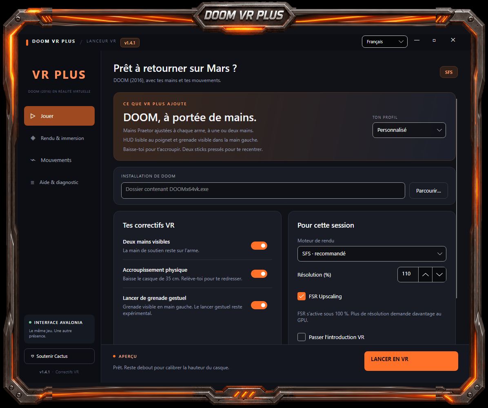

# DOOM VR PLUS

**Fork communautaire de [KHARVOX](https://github.com/CactusVRStudios/KHARVOX), le mod VR pour DOOM (2016) créé par CactusVRStudios.**

DOOM VR PLUS reprend cette base pour améliorer les mains, les gestes, le HUD
et l'interface de lancement. Une installation légitime de DOOM (2016) est requise.
Le projet est indépendant, non affilié à id Software, Bethesda ou ZeniMax.

> **AI-assisted development with OpenAI Codex.**
> Ce fork a été créé et développé avec l'assistance d'OpenAI Codex.
> Le mainteneur pilote les choix, ajuste les poses dans Blender et valide les
> résultats en jeu. L'assistance IA ne remplace pas ces vérifications humaines.

## Le launcher



- Cadre métallique orange **animé**, avec centre transparent.
- Interface **Avalonia**, réglages répartis entre Jouer, Rendu, Mouvements et Aide.
- **Français par défaut**, anglais sélectionnable immédiatement en haut à droite.
- Langue mémorisée séparément des réglages VR.
- Version **v1.4.1** affichée depuis la version réellement compilée.
- Résumé des ajouts et explications des gestes directement dans l'interface.

[Voir le launcher en anglais](Docs/images/launcher-en.png)

## Nouvelles fonctionnalités

| Fonction | Ce qui change | État |
|---|---|---|
| Mains Praetor | Poses ajustées à chaque arme, à une ou deux mains ; articulations de la main libre | Validé en jeu et inclus dans le paquet complet |
| Prise à une main | La main droite réutilise la pose de poignée et de doigts validée dans Blender | Validé sur les dix armes |
| HUD au poignet | HUD suspendu sur l'avant-bras gauche, consultation par orientation du poignet, blocs séparés manuellement | Dernier placement validé en jeu |
| Crouch physique | Baisser le casque d'environ 35 cm pour s'accroupir ; remonter à moins de 20 cm de la hauteur debout pour se relever | Validé localement ; bouton classique conservé |
| Recentrage | Appuyer simultanément sur les deux sticks | Implémenté ; commandes individuelles conservées |
| Grenade tenue | Grenade fragmentaire texturée dans la main gauche avec la pose des doigts validée | Tenue visuelle validée ; main droite conserve l'arme |
| Lancer gestuel | Maintenir la gâchette de soutien, effectuer le geste puis relâcher | Expérimental ; le modèle tenu reste distinct du projectile natif |
| Performances | Corrections des chemins coûteux et partage des atlas des mains | Fluidité retrouvée et confirmée pendant les essais locaux |

Le fork conserve SFS/AER, les commandes classiques et les mécanismes gauchers
existants. Cela ne vaut pas validation de tous les casques et de tous les modes.
Les retours en jeu incluent des contrôleurs **Quest/Touch**.

### Armes validées localement

Pistolet, fusil de combat, Super Shotgun, fusil d'assaut lourd, fusil plasma,
lance-roquettes, canon Gauss, mitrailleuse, BFG 9000 et tronçonneuse.

Les poses ont été réglées dans Blender puis testées en jeu. Le paquet complet
de la release contient les ressources runtime nécessaires à leur affichage.

## Téléchargements

**Première publication complète : version 1.4.1.**

- [Releases GitHub](https://github.com/papoulou/DOOM-VR-PLUS/releases)
- [Paquet Windows complet](https://github.com/papoulou/DOOM-VR-PLUS/releases/download/v1.4.1/DOOM-VR-PLUS-v1.4.1-complet.zip)
- [ZIP des sources](https://github.com/papoulou/DOOM-VR-PLUS/releases/download/v1.4.1/DOOM-VR-PLUS-v1.4.1-sources.zip)
- [Manifeste et empreintes](https://github.com/papoulou/DOOM-VR-PLUS/releases/download/v1.4.1/PACKAGE-MANIFEST.json)

Le ZIP complet contient le launcher compilé, la couche VR, les dépendances,
les shaders SFS/AER et les modèles Praetor validés. Il ne contient ni
exécutable DOOM ni préférence personnelle. [Contenu exact](Docs/PUBLICATION.md).

## Installation

1. Télécharger puis extraire entièrement le paquet complet dans un dossier
   accessible en écriture. Ne pas exécuter le launcher directement depuis le ZIP.
2. Garder une copie de toute ancienne installation KHARVOX fonctionnelle. Ne
   pas installer le mod dans le dossier du jeu.
3. Ouvrir `DOOM_VR_PLUS.cmd`, sélectionner le dossier contenant `DOOMx64vk.exe`,
   puis choisir ses réglages et cliquer sur **LANCER EN VR**.
4. Le menu en haut à droite permet de choisir Français ou English ; le choix
   est enregistré dans `launcher_language.cfg`.

Pour inspecter uniquement le rendu du launcher, utiliser `VOIR_INTERFACE.cmd` :
il ne lance pas le jeu et n'enregistre pas les préférences.

## Limites connues

- Le rendu GLB des bras n'utilise pas encore toutes les lumières dynamiques
  natives de DOOM, notamment lors des flashs de tir.
- La grenade tenue n'est pas encore le projectile natif : son départ depuis
  la main, sa vitesse et son délai restent à raccorder.
- Son aperçu ne lit pas encore le type sélectionné ni le cooldown. Le premier
  essai concerne la frag, main gauche, en mode droitier.
- Les dessins SWF natifs du HUD diffèrent de leur maquette Blender.

## Reprendre le développement

Lire d'abord **[AGENTS.md](AGENTS.md)** et **[Docs/HANDOFF.md](Docs/HANDOFF.md)**.
Ils consignent les règles, l'état des chantiers, les points d'entrée du code,
les tests et les ressources manquantes dans un clone public.

```powershell
git clone --recurse-submodules https://github.com/papoulou/DOOM-VR-PLUS.git
cd DOOM-VR-PLUS
git switch doom-vr-plus
```

`doom-vr-plus` contient le travail du fork ; `main` conserve la référence
upstream au moment du fork.

### Compiler le launcher

Windows et SDK .NET 10 :

```powershell
dotnet publish launcher/KharvoxDesktop/KharvoxDesktop.csproj -c Release -r win-x64 --self-contained true -o build/launcher
```

Pour le runtime C++ et ses dépendances, consulter les instructions
[upstream conservées](README-KHARVOX-UPSTREAM.md). Les fixtures Praetor et les
dépendances du compilateur SFS sont locales/optionnelles : ne pas présenter
leurs tests comme exécutables sans ces ressources.

La validation locale comprend une suite CMake/CTest de 158 tests, des contrôles
GPU dans les deux yeux, les transitions des dix profils d'armes, et les quatre
pages du launcher dans les deux langues. Les tests automatisés complètent les
retours humains ; ils ne garantissent pas toutes les configurations matérielles.

## Signaler un problème

Ouvrir une [issue](https://github.com/papoulou/DOOM-VR-PLUS/issues) avec la version,
le casque, les contrôleurs, le runtime OpenXR, SFS/AER et les étapes du problème.
Retirer les chemins personnels et informations sensibles des journaux joints.

## Crédits et licence

- **CactusVRStudios** : créateur de KHARVOX, base du fork.
- **papoulou** : direction du projet, réglages Blender et validations en jeu.
- **OpenAI Codex** : assistance IA à l'analyse, au développement et aux tests — **AI-assisted**.
- Bibliothèques tierces : [notices d'origine](Docs/THIRD_PARTY_NOTICES.txt).

La [licence MIT et le copyright CactusVRStudios](LICENSE.txt) sont conservés.
Les composants tiers gardent leurs licences. La licence du code ne relicense
ni les ressources ni les marques du jeu. Aucun exécutable DOOM, identifiant,
chemin personnel ou contournement de protection n'est inclus dans les ZIP.

## English summary

DOOM VR PLUS is an independent community fork of CactusVRStudios' KHARVOX for
DOOM (2016). **This fork was created with AI assistance from OpenAI Codex.**
The maintainer directs the work, edits poses in Blender and tests in VR.
The animated Avalonia launcher supports French and English, remembers the
language and shows its compiled version. Local work adds weapon-specific
Praetor poses, a wrist HUD, physical crouching, recentering and a left-hand
visual grenade prototype.

The v1.4.1 Windows download is a complete tested package containing the compiled
launcher, VR layer, SFS/AER profiles and the validated Praetor runtime models.
Players still need their own legitimate installation of DOOM (2016).
Native lighting and a synchronized hand-origin grenade release are unfinished.
Read the release notes, AGENTS.md and HANDOFF.md before installing or contributing.
